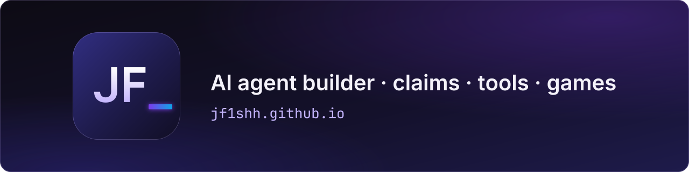

  

# Jared Fisher

I direct teams of AI agents to build real things: claims AI, developer tools and games.

I spent 17 years at Liberty Mutual, 11 of them as a senior appraiser. I started in the mailroom in 2008, moved through claims support and total-loss work, and worked in auto appraisal from October 2014 to September 2026.

In March 2026 I started teaching myself to build with AI, with no coding background. I build RAG tools and multi-agent workflows with AI coding agents. I write the requirements, direct the build, and check the results against the problem the tool is meant to solve.

**[LinkedIn](https://www.linkedin.com/in/jaredfisher-ai/) · [YouTube](https://www.youtube.com/@JaredFisherBuilds) · [Live portfolio](https://jf1shh.github.io/) · [GitHub repositories](https://github.com/jf1shh?tab=repositories)**

Elsewhere: [X](https://x.com/JaredFishe19708) · [Instagram](https://www.instagram.com/jf1shh/) · [itch.io](https://jf1shh.itch.io/)

## Featured projects

### ClaimsRAG

An independent, local-first claims retrieval project, built with AI coding agents on synthetic data. It uses hybrid retrieval, reranking, claim-scoped documents and source citations, and it is scored with dated answer-quality and adversarial evaluations. A person makes the claims decisions. The README records the results and their limits. This is a portfolio proof of concept.

[Repository and evaluation](https://github.com/jf1shh/claims-rag)

### Agentic App Harness

A spec-driven framework for AI-assisted app development, with six deployed web and mobile demos. CI runs contract-first Zod schemas, behavior-driven unit and end-to-end tests, and automated accessibility checks. A deterministic loop (sense, propose, act, verify, learn) detects drift and writes work orders for a coding agent. It has no embedded LLM and needs no API key.

[Live showcase](https://jf1shh.github.io/agentic-app-harness/) · [Repository](https://github.com/jf1shh/agentic-app-harness)

### Jump Cut

A stunt-driving game where you direct the cut: drive each stunt, or hold to cut past it. My solo entry to the 2026 Epic AI MegaJam (Nov 11-15), made in Unreal Engine 5.9 with AI agents (Claude Code).

[Play](https://jf1shh.itch.io/jump-cut) · [Trailer](https://youtu.be/0jnfxe_LziE) · [Dev log](https://jf1shh.github.io/jump-cut-jam-tools/) · [Press kit](https://jf1shh.github.io/jump-cut-jam-tools/press-kit/) · [Source](https://github.com/jf1shh/jump-cut-jam-tools)

## Claims experience and AI enablement

My appraisal work covered supplement review, total loss determinations, fraud indicators, subrogation and complex shop disputes. It shapes my requirements: guidance people can use, evidence they can trace, and a clear line between what the assistant says and what a person decides.

At Liberty Mutual, I designed and piloted a RAG-based appraisal assistant and built and demoed a total-loss assistant. I also built PII scrubbing and photo PII redaction tools that were distributed to the team. I wrote a department expansion playbook, built a prompt library, and ran a cross-team training session. The assistants were pilots and demos; they were not deployed team-wide.

## What I'm looking for

I am looking for AI product, solutions, implementation and enablement roles in insurance and claims, at InsurTechs, claims-software companies, carrier AI and claims-transformation teams, and in insurance AI evaluation. Frontline claims experience decides whether these tools get used. I am also open to auto damage appraisal and total-loss claims roles. I am based in Seattle, Washington, want remote work, and can start immediately.

[Connect on LinkedIn](https://www.linkedin.com/in/jaredfisher-ai/).
