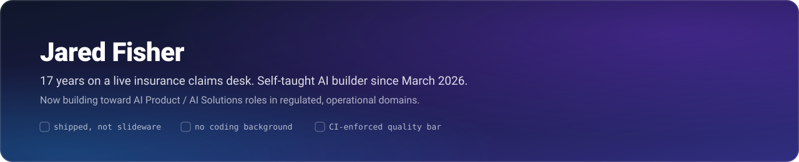

  

I spent 17 years on a high-volume insurance claims desk before I ever wrote a line of code. Two years ago I started teaching myself to build with AI — no CS background, no bootcamp — because I kept seeing the gap between what frontline operational work actually needs and what most software assumes about it. I still work that desk. I build in the hours around it.

That combination is the whole thesis: **domain fluency in a regulated, high-volume operational environment, plus the ability to actually ship the tool the domain needs.**

### 🚀 Featured: Agentic App Harness

A spec-driven development harness that holds six real, deployed apps to one enforced quality bar — contract-first Zod schemas, BDD unit + E2E tests, accessibility gates, all **enforced in CI, not just documented.** It also closes its own improvement loop (Sense → Propose → Act → Verify → Learn) with **no embedded LLM and no API key** — the AI coding agent is a pluggable actuator, not a hardcoded dependency.

**[→ Live showcase](https://jf1shh.github.io/agentic-app-harness/) · [→ Repository](https://github.com/jf1shh/agentic-app-harness)**

  
  
  

### 🧰 What I build with

  
  
  
  
  
  
  
  

### 🎯 What I'm building toward

AI Product / AI Solutions roles in regulated, operational domains — insurance, claims, InsurTech — where deep domain fluency and the ability to ship compound. I'm most useful where the AI has to work inside real constraints: compliance, audit trails, high transaction volume, and users who have zero patience for a tool that guesses.
